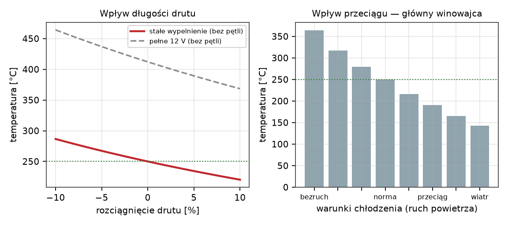
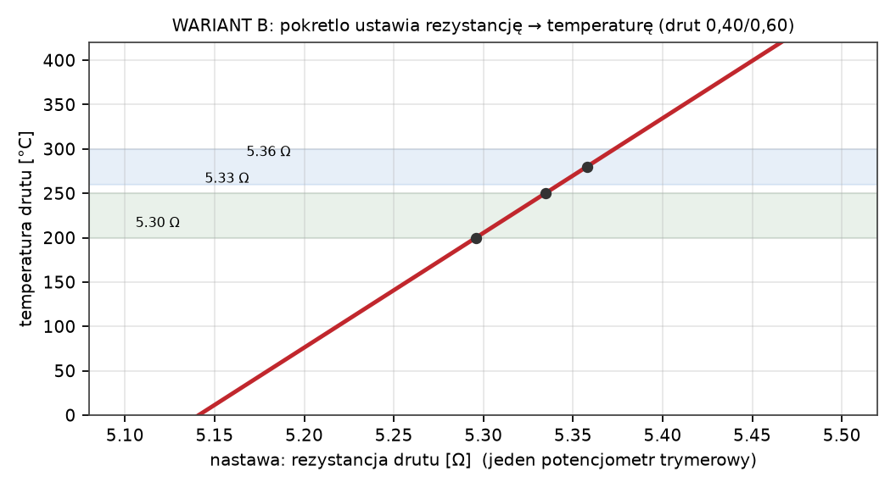
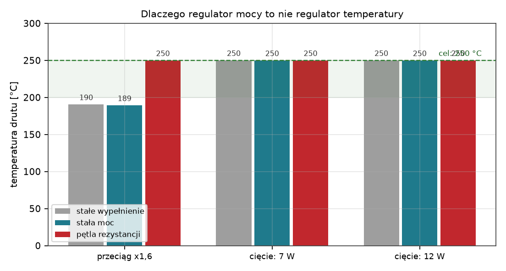
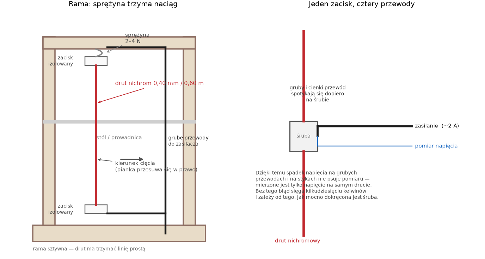
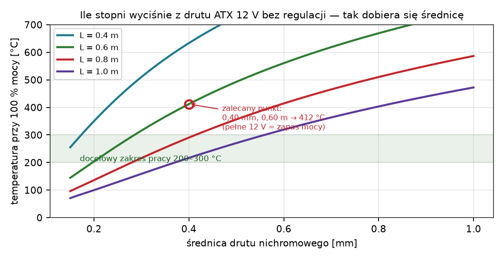
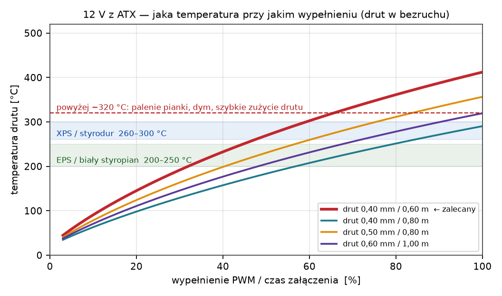
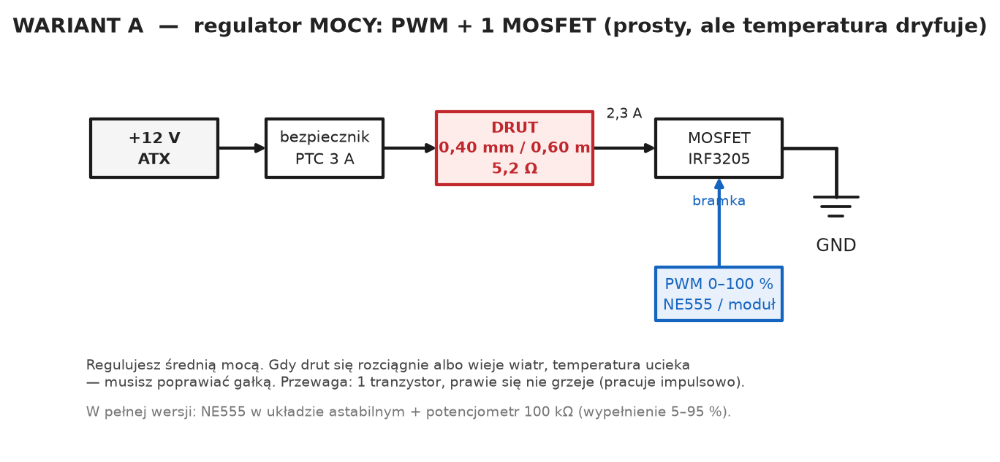
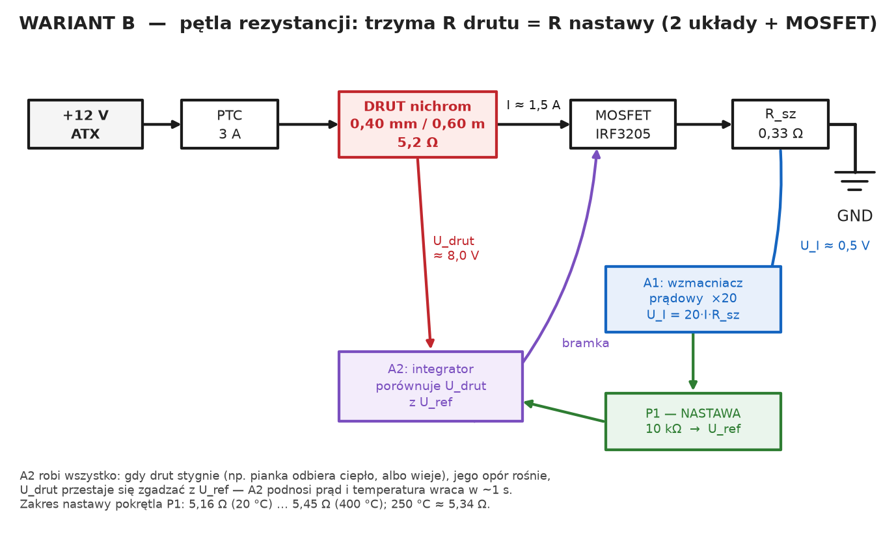
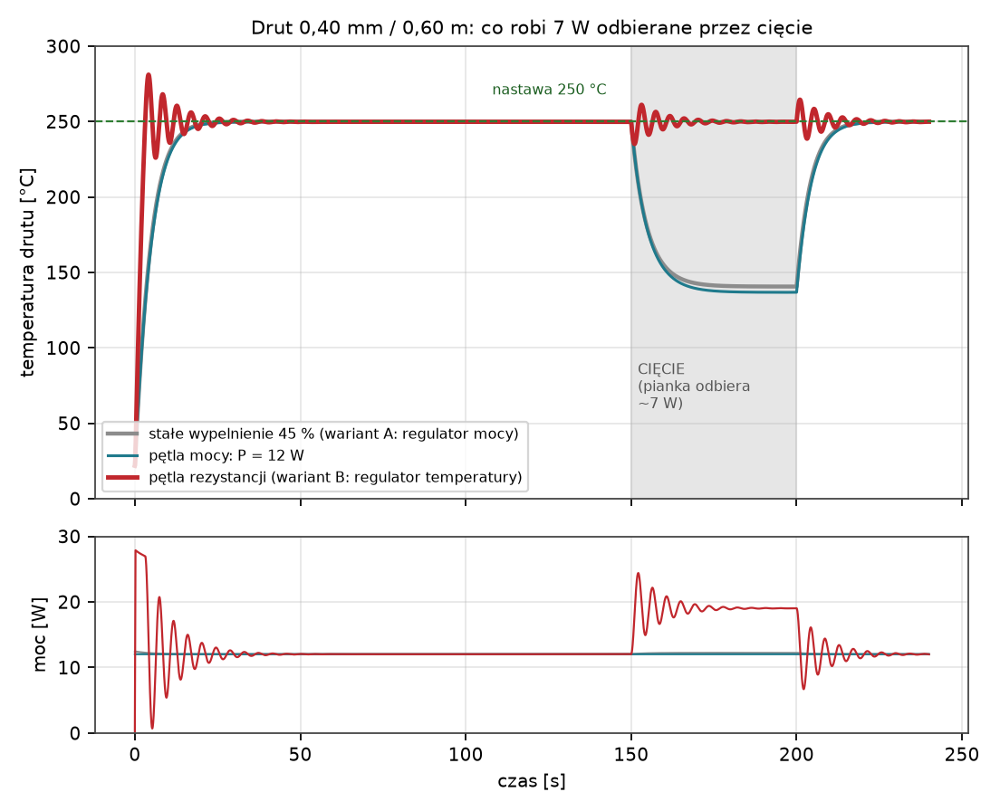

# Analogowa regulacja temperatury drutu do cięcia styropianu i styroduru

Projekt układy sterowania drutem oporowym: **ATX 12 V, drut nichromowy, czysty analog,
maksymalnie dwa elementy półprzewodnikowe + MOSFET** (bez żadnego mikrokontrolera).

Wszystkie liczby w tym dokumencie policzone są modelem z
`docs/obliczenia/model_drutu.py` (termika drutu + symulacje pętli). Wykresy są w
`docs/charts/`. Model jest rzędu wielkości (±20 %) — służy do doboru drutu i pokazania,
**które efekty są duże, a które pomijalne**, nie do dokładnych przewidywań.

---

## 1. Co jest właściwie problemem

Trzy rzeczy, które psują cięcie:

| Zjawisko | Skutek | Czy da się rozwiązać mechanicznie? |
|---|---|---|
| Drut wydłuża się przy grzaniu (~1,9 mm na 0,6 m) | zwisa, przestaje być linią | **tak** — sprężyna (bo zwis i tak jest 0,05 mm) |
| Zmiany chłodzenia (przeciąg, otwarte okno, inna pianka) | temperatura ucieka o dziesiątki stopni | **nie** — to jest jedyny prawdziwy problem |
| Zmiany napięcia / rezystancji styków | dryf o kilka stopni | nie |

<figure>

</figure>

Przy stałym wypełnieniu PWM (wariant „regulator mocy”) sam przeciąg w warsztacie zmienia
temperaturę z 251 °C na 190 °C, a przy otwartym oknie na 143 °C. Dlatego **regulator mocy
nie jest regulatorem temperatury** — trzeba mierzyć coś, co zależy od temperatury drutu.

---

## 2. Kluczowa decyzja: mierzymy rezystancję drutu, nie temperaturę

Drut nichromowy **jest** czujnikiem temperatury: jego opór rośnie o ok. 0,00015 /K, czyli
o **~1 % na 65 °C** (drut 0,40 mm / 0,60 m: 5,16 Ω zimny → 5,33 Ω przy 250 °C).

<figure>

</figure>

| Temperatura drutu | Opór drutu 0,40 mm / 0,60 m |
|---:|---:|
| 20 °C | 5,16 Ω |
| 150 °C | 5,26 Ω |
| 200 °C | 5,30 Ω |
| 250 °C (styropian) | **5,33 Ω** |
| 280 °C (styrodur) | 5,36 Ω |
| 300 °C | 5,37 Ω |
| 400 °C (górna granica) | 5,45 Ω |

Wystarczy więc trzymać **stałą rezystancję drutu** — a to jest najprostsza rzecz do
zmierzenia: napięcie na drucie podzielone przez prąd (prawo Ohma). Pętla robi to sama.

### Dlaczego nie „stałe napięcie na drucie”

Kuszące uproszczenie („12 V to za dużo, więc dam 8 V i będzie 250 °C”) **nie działa**:
napięcie na drucie zależy od temperatury tylko przez opór, więc kompensuje zaledwie
kilka procent zakłóceń. Symulacja:

<figure>

</figure>

| Sytuacja (cel: 250 °C) | Stałe wypełnienie 45 % | Stała moc 12 W | **Pętla rezystancji** |
|---|---:|---:|---:|
| przeciąg ×1,6 | 190 °C | 189 °C | **250 °C** |
| przeciąg ×2,5 (okno) | 143 °C | 141 °C | **250 °C** |
| cięcie: pianka odbiera 7 W | 251 °C | 250 °C | **250 °C** |
| cięcie: pianka odbiera 12 W | 250 °C | 250 °C | **250 °C** |

(Uwaga: „stała moc” i „stałe wypełnienie” w spoczynku trzymają temperaturę, ale w momencie
cięcia temperatura runie do 140 °C — w tabeli widać to dopiero w symulacji dynamiki,
patrz rozdz. 6. Wynika to z tego, że w pierwszej chwili cięcia pianka odbiera ciepło,
a drut o masie 0,6 g nie ma go z czego oddać.)

---

## 3. Mechanika — to trzeba zrobić dobrze, niezależnie od elektroniki

<figure>

</figure>

1. **Rama sztywna** (metal lub sklejka 18 mm + usztywnienia). Drut musi być linią prostą,
   bo każde ugięcie ramy to krzywe cięcie. Nie sklejka 10 mm.
2. **Sprężyna rozciągowa** u góry, naciąg 2–4 N. Drut przy 250 °C wydłuża się o 1,9 mm —
   sprężyna to zbiera. Zwis przy naciągu 4 N wynosi 0,05 mm, więc „rozciąganie” nie jest
   żadnym problemem geometrycznym, jeśli sprężyna jest.
3. **Zaciski izolowane ceramicznie** (kostka ceramiczna / preszpan + śruba M3). Drut nie
   może dotykać ramy — przy 12 V i ramie metalowej to zwarcie.
4. **Pomiar 4-przewodowy**: cienkie przewody pomiarowe przykręcaj **przy samym drucie**
   (na tej samej śrubie co grube zasilające). Dzięki temu spadek napięcia na grubych
   przewodach i na stykach nie fałszuje pomiaru. Błąd rzędu 10 mΩ to ~13 °C.
5. Materiał na drut: **nichrom 80/20** (NiCr), nie „drut oporowy z allegro bez opisu”.
   Kanthal ma mniejszy współczynnik temperaturowy i gorszą powtarzalność pętli.

> **Zasilacz ATX**: obciążaj tylko żółty (+12 V) i czarny (GND). Sprawa, którą trzeba
> wiedzieć: tanie ATX-y bez obciążenia na +5 V czasem nie startują albo mają niestabilne
> +12 V — jeśli tak jest, obciąż +5 V żarówką samochodową 12 V/5 W albo rezystorem 10 Ω/5 W.
> Grubość przewodów: 1 mm² spokojnie wystarczy na 2,5 A.

---

## 4. Dobór drutu do 12 V (to decyduje o wszystkim)

Kryterium: przy 100 % mocy drut ma osiągnąć ~400 °C, żeby został zapas na wiatr i na
chłodzenie przez piankę. Wtedy 200–300 °C wypada w środku zakresu regulacji.

<figure>

</figure>

| Długość drutu | Średnica | R zimny | Prąd (100 %) | Moc (100 %) | T przy 100 % |
|---:|---:|---:|---:|---:|---:|
| 0,40 m | 0,23 mm | 10,4 Ω | 1,1 A | 13 W | 403 °C |
| 0,50 m | 0,31 mm | 7,2 Ω | 1,6 A | 19 W | 408 °C |
| **0,60 m** | **0,39–0,40 mm** | **5,4 Ω** | **2,1 A** | **25 W** | **403 °C** |
| 0,80 m | 0,57 mm | 3,4 Ω | 3,4 A | 40 W | 398 °C |
| 1,00 m | 0,79 mm | 2,2 Ω | 5,2 A | 62 W | 400 °C |

**Rekomendacja: nichrom 0,40 mm, długość 0,60 m** (albo 0,39 mm z tabeli — w handlu
0,40 mm jest standardem). Pobór maksymalny 2,3 A, więc ATX 10 A jest wykorzystany
w jednej czwartej i będzie pracował bez głośnego wentylatora.

<figure>

</figure>

Punkty pracy zalecanego drutu (12 V, bezruch):

| Temperatura | Wypełnienie PWM | Moc | Prąd | Napięcie na drucie |
|---:|---:|---:|---:|---:|
| 150 °C | 21 % | 5,7 W | 1,05 A | 5,5 V |
| 200 °C | 32 % | 8,7 W | 1,28 A | 6,8 V |
| 250 °C | 45 % | 12,0 W | 1,50 A | 8,0 V |
| 280 °C | 53 % | 14,3 W | 1,63 A | 8,7 V |
| 300 °C | 59 % | 15,9 W | 1,72 A | 9,2 V |

Ile mocy potrzeba do utrzymania 250 °C w różnych warunkach:

| Warunki | Wypełnienie | Moc | Prąd |
|---|---:|---:|---:|
| bezruch | 27 % | 7,2 W | 1,16 A |
| normalnie | 45 % | 12,0 W | 1,50 A |
| lekki przeciąg | 66 % | 17,9 W | 1,83 A |
| wiatr / otwarte okno | 99 % | 26,6 W | 2,23 A |

Czyli **cały potrzebny zakres mocy to 7–27 W** — i dokładnie to musi pokryć układ.

---

## 5. Wariant A — regulator mocy (najprostszy, „na start”)

<figure>

</figure>

PWM 0–100 % z NE555 (albo gotowego modułu PWM za 15 zł) → bramka MOSFET-u → drut.

* Elementy półprzewodnikowe: **1 MOSFET**. NE555 to układ, ale można go zastąpić modułem.
* MOSFET **nie grzeje się** (pracuje impulsowo, RDS(on) = 8 mΩ → 0,04 W).
* Regulacja jest **ręczna**: pokrętło ustawia moc, a gdy warunki się zmienią, temperatura
  ucieka i trzeba poprawić. Do „raz na jakiś czas” wystarczy; do powtarzalnych cięć nie.

## 6. Wariant B — pętla rezystancji = regulator temperatury (docelowy)

<figure>

</figure>

### Jak to działa w jednym zdaniu

Układ mierzy **prąd** drutu (spadek na R_sz) i **napięcie** na drucie (4-przewodowo),
a integrator (A2) dobiera prąd tak, żeby **Udrut = Rnastawy · I**.
To warunek stałej rezystancji, czyli stałej temperatury. Potencjometr P1 ustawia
Rnastawy (5,16 Ω = zimny … 5,45 Ω = 400 °C).

Kaskada: **A1** (wzmacniacz prądowy ×20) → **P1** (nastawa) → **A2** (integrator) →
bramka MOSFET-u. Pętla jest szybka, bo rezystancja drutu reaguje natychmiast, a nie po
kilku sekundach jak termometr przyklejony do drutu.

### Lista elementów

| # | Element | Wartość / typ | Uwagi |
|---|---|---|---|
| U1 | LM358 (2 wzmacniacze w jednej obudowie) | DIP-8 | A1 i A2. Zwykły „podstawowy” wzmacniacz, nie potrzebuje rail-to-rail |
| Q1 | IRF3205 albo IRLZ44N, BUZ11, IRF540 | N-MOSFET, >5 A, >30 V | pracuje liniowo; **musi mieć radiator** |
| R_sz | rezystor pomiarowy | **0,33 Ω / 2 W**, 1 % | drut oporowy albo 3× 1 Ω równolegle |
| R1 | rezystor wejściowy A1 | 1 kΩ | |
| R2 | sprzężenie zwrotne A1 | 19 kΩ (albo 18 k + 1 k) | wzmocnienie ×20 |
| R3 | rezystor wejściowy A2 | 100 kΩ | |
| R4 | rezystor bramki | 220 Ω | |
| R5 | podciąganie/ściąganie bramki | 10 kΩ | pewny stan przy starcie |
| C1 | kondensator integratora | **1 µF** foliowy (MKT), 63 V | 470 nF–2,2 µF — patrz „regulacja” |
| P1 | potencjometr nastawy | 10 kΩ liniowy (o ile się da — 10-obrotowy helipot) | obudowa, gałka z podziałką |
| P2 | potencjometr kalibracji | 1 kΩ trymer | ustawia „ile woltów na amper” (×20) |
| F1 | bezpiecznik | PTC 3 A (albo zwłoczny 2,5 A) | na +12 V |
| D1 | dioda gasząca | 1N5408 (opcjonalnie) | między drenem a +12 V, chroni przy indukcyjności przewodów |
| C2, C3 | 100 nF + 100 µF | przy LM358 | zasilanie wzmacniaczy |

**Bilans półprzewodników: 2 sztuki** — LM358 (dwa wzmacniacze) + MOSFET. Nic więcej.

### Połączenia (do wlutowania)

**Zasilanie:** +12 V z ATX (żółty) → PTC 3 A → **drut** → dren Q1; źródło Q1 → R_sz →
GND (czarny). To jest jedyna pętla prądowa — przez drut płynie ten sam prąd, co przez R_sz.

| Punkt | Do czego |
|---|---|
| Q1 dren | drut (górny zacisk) |
| Q1 źródło | R_sz (koniec „gorący”), do A1 „+” |
| R_sz (koniec do masy) | GND, do A1 „−” przez R1 |
| Q1 bramka | przez R4 do wyjścia A2; R5 10 kΩ bramka–GND |
| A1 „+” | górny koniec R_sz |
| A1 „−” | GND przez R1 1 kΩ, oraz R2 19 kΩ z wyjścia A1 |
| A1 wyjście | górny koniec P1 |
| P1 suwak | A2 „+” (U_ref) |
| A2 „−” | drut górny zacisk **przez R3 100 kΩ**; C1 1 µF z wyjścia A2 do tego samego punktu |
| A2 wyjście | R4 220 Ω → bramka Q1 |
| LM358 zasilanie | +12 V przez 100 Ω + 100 µF, GND; nóż 4 = GND, nóż 8 = +12 V |

> Uwaga do LM358: przy zasilaniu 12 V i wyjściu sterującym bramką MOSFET-u potrzebny jest
> zapas ~2 V na bramce. Jeśli Twój egzemplarz IRF3205 (Vgs(th) = 2–4 V) nie otwiera się
> pewnie, weź **IRLZ44N** (Vgs(th) 1–2 V) — to najczęstszy powód „układ nie grzeje”.

### Kalibracja (15 minut, raz)

1. Ustaw P2 (kalibracja wzmocnienia A1) tak, żeby przy prądzie 1,5 A wyjście A1 miało 1,5 V.
   Najprościej: amperomierz w szeregu z drutem (drut zimny, ok. 2 A na chwilę), woltomierz
   na wyjściu A1 — kręć P2, aż U_A1 = 20 · I.
2. Pokrętło P1 na minimum (R_nastawy = 5,16 Ω) — drut zimny, na wyjściu A1 zero.
3. Ustaw P1 na 250 °C (pośrodku skali) i porównaj z pirometrem / „testem cięcia”.
   Jeśli przy pełnym pokrętle nie dobija do 400 °C — za mała wartość R2 (zwiększ wzmocnienie).

### Jak to się zachowuje (symulacja pętli)

<figure>

</figure>

* **Niemal natychmiastowa odpowiedź na cięcie**: gdy pianka odbiera 7 W, temperatura spada
  o ~1 °C, a nie o 110 °C. Powód: rezystancja reaguje natychmiast, więc pętla podnosi moc
  w ułamku sekundy, zanim drut zdąży wystygnąć.
* **Po wyjściu z cięcia** jest krótki „podskok” ~15 °C (całka zdążyła się nasycić przy
  pełnej mocy). Nie przeszkadza w cięciu; jeśli chcesz go zmniejszyć, daj większy C1
  (2,2 µF) albo mniejsze wzmocnienie A2.
* **Odporność na przeciąg i otwarte okno**: 250 °C niezależnie od tego, czy w warsztacie
  wieje (zakres mocy 7–27 W pokrywa wszystko).
* **Stabilność**: pętla jest całkująca z bardzo krótką stałą czasu obiektu (~0,06 s przy
  pełnej mocy), więc nie ma oscylacji; czas dojścia od zimna do 250 °C to ~3 s.
* **Rozciągnięcie drutu** (po przełożeniu drutu, po zmianie naciągu): rezystancja
  całego obwodu się zmienia, więc trzeba **raz przekalibrować P1** (albo dać drutowi
  10 minut na ustabilizowanie geometrii). To jest jedyna wada tej metody.

### Regulacja, jeśli coś oscyluje

* Wolno „pompuje” (okres 1–5 s) → **zwiększ C1** (1 µF → 2,2 µF).
* Reaguje ospale → zmniejsz C1 (1 µF → 470 nF).
* W ogóle nie grzeje / pracuje w skrajnym punkcie → sprawdź Vgs(th) MOSFET-u (patrz uwaga
  wyżej), ewentualnie zmniejsz R4 do 100 Ω i dodaj 100 nF między bramkę a GND.

---

## 7. Termostat dwustanowy — czy warto?

Krótka odpowiedź: **nie**, chyba że chcesz układ na jednym komparatorze i akceptujesz
oscylacje. Policzone (drut 0,40/0,60, pełne 12 V):

| Histereza | Opóźnienie czujnika | Wahania temperatury | Średnia |
|---:|---:|---:|---:|
| ±1 °C | 0,1 s | 7 °C | 250 °C |
| ±2 °C | 0,4 s | 21 °C | 250 °C |
| ±5 °C | 1,0 s | 49 °C | 251 °C |
| ±10 °C | 1,0 s | 63 °C | 251 °C |

Drut ma masę 0,6 g i stałą czasu kilka sekund — termostat z czujnikiem „obok drutu”
będzie latał między 100 % a 0 % z okresem kilku sekund. Do cięcia pianki to za dużo:
temperatura musi być w pasie ±10 °C. **Pętla ciągła (wariant B) jest prostsza w skutkach**,
nawet jeśli sam schemat jest większy.

---

## 8. Sprawdzenie, czy 12 W wystarczy na cięcie

Pianka EPS λ=0,038 gęstość ~15 kg/m³: potrzeba ~700 kJ na kg odparowania/depolimeryzacji.
Dla szczeliny 0,2–0,4 mm, prędkości 5 cm/s i grubości 10 cm wychodzi **5–20 W** — czyli
zalecany drut (12 W przy 250 °C) jest na granicy dla grubych kawałków. W praktyce:

* cienkie płyty (2–5 cm) — idzie szybko, mam zapas,
* grube bloki (20 cm) — **zwolnij** albo podnieś nastawę do 280–300 °C,
* styrodur XPS — twardszy, tnie się przy 260–300 °C, węgiel na drucie jest normalny.

---

## 9. BHP, trzy zdania, które warto przeczytać

1. Drut 250 °C wygląda jak zimny metal. **Nie dotykaj**; po wyłączeniu stygnie ~1 min.
2. Pianka pali się i wydziela styren/cyjanowodór — **cięcie tylko przy otwartym oknie
   albo pod wyciągiem**, nie w zamkniętym pokoju.
3. ATX trzyma +5 V SB po wyłączeniu; wyciągaj wtyczkę z gniazda, zanim grzebiesz w obwodzie.

---

## 10. Co wybrać — decyzja w jednym akapicie

* **Chcesz ciąć od czasu do czasu, jedna grubość pianki:** wariant A (PWM + MOSFET).
  Koszt ~30 zł, jedna gałka, kalibrujesz „na wyczucie” i tyle.
* **Chcesz powtarzalnych cięć, różne pianki, warsztat z przeciągiem:**
  **wariant B (pętla rezystancji)** — LM358 + MOSFET, ~60 zł. To jest odpowiedź na pytanie
  „jak utrzymać stałą temperaturę drutu”, a nie tylko „jak zmniejszyć moc”.

---

### Pliki projektu

| Plik | Zawartość |
|---|---|
| `docs/obliczenia/model_drutu.py` | model termiczny, dobór drutu, symulacje pętli, wszystkie liczby z tego dokumentu |
| `docs/obliczenia/rysunki.py` | schematy blokowe wariantów A i B |
| `docs/charts/t_vs_duty.png` | temperatura drutu a wypełnienie |
| `docs/charts/tmax_vs_d.png` | dobór średnicy drutu do 12 V |
| `docs/charts/wrazliwosc.png` | wpływ rozciągnięcia i przeciągu |
| `docs/charts/strategie.png` | porównanie strategii regulacji |
| `docs/charts/nastawa_vs_temperatura.png` | nastawa rezystancji → temperatura |
| `docs/charts/dynamika.png` | zachowanie w trakcie cięcia |
| `docs/charts/mechanika.png` | rama, sprężyna, zacisk 4-przewodowy |
| `docs/charts/schemat_A.png`, `schemat_B.png` | schematy blokowe |
